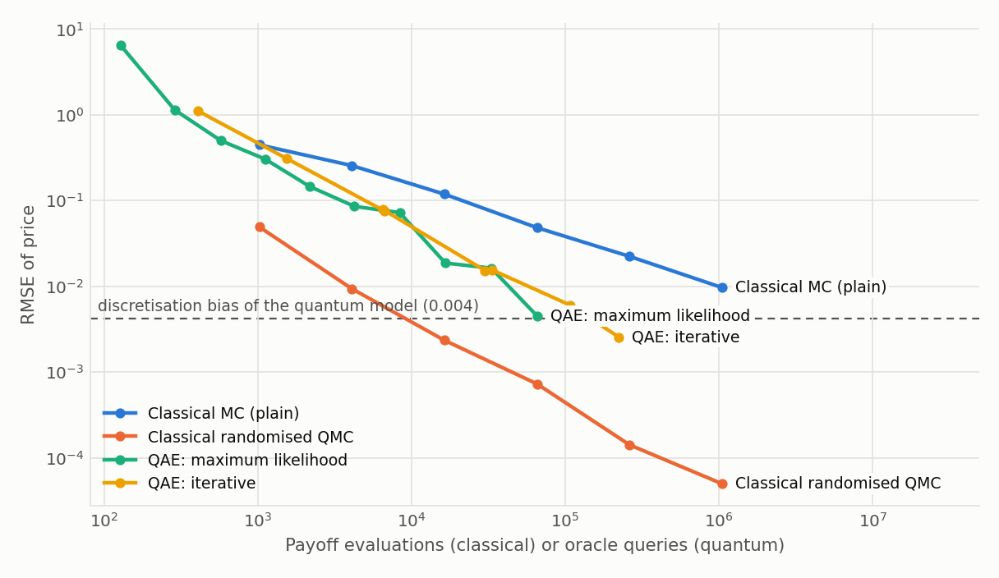

# Quantum Monte Carlo Options Pricing Engine

> Derivatives pricing + amplitude-estimation research prototype

**Status:** Implemented as a CPU-only research prototype. Every quantum number below comes from **noiseless local simulation**; no QPU was used, and nothing here claims a quantum advantage.

## Overview

Prices European, Asian and barrier options under Black–Scholes with classical Monte Carlo and with quantum amplitude estimation (QAE), then compares them on error, evaluation counts, circuit size and time.

### Research question

When state-preparation and oracle costs are included, how do QAE estimators compare with well-optimized classical simulation at a target error?

### Answer from the demo run

For these small instances, classical simulation wins on every end-to-end measure.

- **The 1/ε query scaling is real in simulation.** Fitted log–log slopes of error against oracle queries are −1.04 (maximum-likelihood QAE) and −0.96 (iterative QAE), against −0.56 for plain Monte Carlo.
- **Randomised quasi-Monte Carlo gets the same slope classically** (−0.99) with a constant about 13 times smaller. For a price RMSE of 0.01 it needs about 4,300 payoff evaluations; iterative QAE needs about 55,000 oracle queries.
- **A query is far more expensive than a payoff evaluation.** One Grover iteration on the 6-qubit European circuit is 208 CX gates, and the deepest circuit for that 0.01 target has about 45,000 CX gates. NumPy does the equivalent classical work in about 0.1 ms.
- **Discretisation error dominates for path-dependent payoffs.** With 3 qubits per monitoring date the discretised model is off by 0.08 (Asian) and 0.37 (barrier), which is roughly 15 to 45 times the estimation error.
- **Deep circuits are fragile.** In a toy depolarising model with Grover powers up to 128, a 0.5% error per Grover iteration drops 95% interval coverage to 33%.



## System architecture

```text
configs/demo.yaml
   │
   ├─ prepare_data ──► data/gbm_paths.npz + manifest (seeded synthetic GBM paths)
   │
   ├─ run --solver classical ──► analytic references, MC / antithetic / control variate / RQMC,
   │                             Greeks, error curves, NumPy and C++ throughput
   │
   ├─ run --solver quantum-sim ─► discretise → load distribution → payoff rotation → Grover operator
   │                              → direct sampling / MLAE / IQAE → price, interval, resources
   │
   └─ report ──► reports/comparison.html, figures, CSV tables
```

**Design boundary:** the quantum part is an offline research component. Anything latency-critical stays classical.

## What is implemented

| Area | Module | Notes |
|---|---|---|
| Closed forms | `qmc_options/analytic.py` | Black–Scholes price and Greeks, discrete geometric Asian, continuous up-and-out barrier with continuity correction |
| Classical Monte Carlo | `qmc_options/classical_mc.py` | Plain, antithetic, control variate, randomised Sobol QMC; finite-difference Greeks with common random numbers |
| C++ baseline | `pricing-cpp/mc_pricer.cpp` | C++20 multithreaded kernel for the same four contracts; optional |
| Discretisation | `qmc_options/quantum/discretize.py` | Truncated, binned normal increments per monitoring date; brute-force exact price of the discretised model |
| Circuits | `qmc_options/quantum/encoding.py` | Grover–Rudolph distribution loader, lookup-table payoff rotation, Grover operator (Qiskit) |
| Estimators | `qmc_options/quantum/amplitude_estimation.py` | Direct sampling, maximum-likelihood AE, iterative AE, query accounting, toy noise model |
| Resources | `qmc_options/quantum/resources.py` | Qubits, depth, CX and rotation counts after compiling to CX/RZ/SX/X |
| Experiments | `qmc_options/run.py`, `report.py` | Multi-seed runs, convergence curves, discretisation sweep, cost extrapolation |

Contracts: European call and put, discretely monitored arithmetic Asian call, discretely monitored up-and-out call.

## Mathematical approach

The discounted price is `V = e^(−rT)·E[f(S)]`. The quantum circuit `A` prepares

```text
A|0> = Σ_i sqrt(p_i) |i> ( sqrt(1 − g_i)|0> + sqrt(g_i)|1> ),   g_i = f_i / f_max
```

so the probability of reading 1 on the last qubit is `a = E[f]/f_max` and `V = e^(−rT)·f_max·a`. Sampling `A` directly converges like Monte Carlo, `O(1/ε²)`. Amplitude estimation runs `Q^k A` for growing `k`, where `Q` is the Grover operator, and reaches `O(1/ε)` oracle queries in the ideal case. An oracle query is one application of `A` or its inverse; a shot of `Q^k A` costs `2k + 1` queries.

Each monitoring date gets its own small register holding a binned normal increment, so a path-dependent payoff over `d` dates and `m` qubits per date enumerates `2^(d·m)` paths. The same table gives the exact price of the discretised model, which is the answer the circuit should return.

## How to run

Requires Python 3.9+. The demo takes under a minute on a laptop CPU.

```bash
python3 -m venv .venv && .venv/bin/pip install -e ".[dev]"     # or: pip install -r requirements.txt && pip install -e .

.venv/bin/python -m project.prepare_data --config configs/demo.yaml
.venv/bin/python -m project.run --config configs/demo.yaml --solver classical
.venv/bin/python -m project.run --config configs/demo.yaml --solver quantum-sim
.venv/bin/python -m project.report --runs runs/ --output reports/comparison.html --config configs/demo.yaml

.venv/bin/python -m pytest          # 86 tests, about 5 s
```

`project.*` are thin aliases for `qmc_options.*`. Runs are written to `runs/<name>-<solver>.json`; each holds a manifest (config hash, seeds, library versions, platform, wall time) and the raw per-seed results.

Optional C++ baseline (picked up automatically by the classical run once built):

```bash
cmake -S pricing-cpp -B pricing-cpp/build && cmake --build pricing-cpp/build
```

## Results (demo config, 10 seeds, 95% intervals)

Market: spot 100, rate 5%, volatility 20%, strike 100, one year. Full tables are in `reports/comparison.html`.

### Classical, 200,000 paths per estimate

| Instrument | Reference | Plain MC mean abs. error | Best method | Its mean abs. error |
|---|---|---|---|---|
| European call | 10.4506 (closed form) | 0.029 | Randomised QMC | 0.0002 |
| European put | 5.5735 (closed form) | 0.019 | Randomised QMC | 0.00005 |
| Asian call, 3 dates | 7.3304 (4.2M-path QMC) | 0.017 | Randomised QMC | 0.0003 |
| Up-and-out call, 3 dates, barrier 130 | 4.8969 (4.2M-path QMC) | 0.017 | Randomised QMC | 0.004 |

Intervals contained the reference in 9 or 10 of 10 seeds for every method. Throughput for plain European paths is about 6×10⁷ paths/s in single-threaded NumPy and about 3×10⁸ paths/s in the 10-thread C++ kernel on the development machine (Apple silicon); these vary from run to run.

### Quantum simulation, iterative QAE with amplitude tolerance 0.002

| Instrument | Qubits | Exact price of discretised model | Bias vs reference | Mean abs. error vs discretised | Mean oracle queries | Largest circuit (CX) |
|---|---|---|---|---|---|---|
| European call | 6 | 10.4548 | +0.004 | 0.014 | 28,430 | 36,046 |
| European put | 6 | 5.5696 | −0.004 | 0.006 | 26,350 | 38,542 |
| Asian call, 3 dates | 10 | 7.4111 | +0.081 | 0.006 | 33,400 | 239,954 |
| Up-and-out call, 3 dates | 10 | 5.2669 | +0.370 | 0.008 | 13,980 | 128,594 |

Iterative QAE intervals contained the discretised price in 10 of 10 seeds for all four contracts. Maximum-likelihood QAE reached similar accuracy with 13,300 queries, but its intervals covered in only 8 of 10 seeds on the barrier option; across the scaling study its coverage ranged from 80% to 100% against a nominal 95%, because the interval is an asymptotic approximation.

### Convergence fits (European call)

| Estimator | Log–log slope | Largest budget | RMSE there |
|---|---|---|---|
| Classical MC, plain | −0.56 | 1,048,576 paths | 0.0097 |
| Classical randomised QMC | −0.99 | 1,048,576 paths | 0.00005 |
| QAE, maximum likelihood | −1.04 | 65,824 queries | 0.0045 |
| QAE, iterative | −0.96 | 223,248 queries | 0.0026 |

### Extrapolated cost at a target price RMSE (European call)

| Target RMSE | Plain MC paths | RQMC points | Iterative QAE queries | CX gates in the deepest QAE circuit |
|---|---|---|---|---|
| 0.1 | 18,000 | 430 | 5,000 | 3,600 |
| 0.01 | 1.1 million | 4,300 | 55,000 | 45,000 |
| 0.001 | 64 million | 44,000 | 600,000 | 580,000 |

These come from the fitted slopes. The report also converts queries to device time and T-counts under gate-time assumptions set in `configs/demo.yaml`; those columns are assumptions, not measurements.

### Other findings

- **Truncation matters more than resolution.** With the normal cut at ±3σ the European call bias stalls near 0.10 however many qubits are added, because the cut removes upside tail. At ±4σ, 5 qubits give 0.004. See `reports/figures/discretization.png`.
- **Loading cost doubles per qubit.** The `A` circuit goes from 62 CX at 5 qubits to 510 CX at 8, since both the loader and the payoff rotation are exact lookup tables.
- **Quantum delta is expensive.** A central difference of two iterative-QAE prices with a 5% bump gave 0.637 with interval [0.633, 0.640] for 158,000 queries; at a 1% bump the interval widened to [0.622, 0.701]. Classical finite differences with common random numbers gave 0.635 ± 0.001 from 200,000 paths.

## Benchmark protocol

1. Tiny instances are checked against closed forms or brute-force enumeration (in the tests and in every run).
2. Both solvers read the same config: same market, contracts, monitoring dates and seeds.
3. Budgets are reported in payoff evaluations or oracle queries, alongside wall time.
4. Circuit construction, compilation and simulation are timed separately from estimation.
5. Every stochastic result is repeated over the seeds declared in the config, with interval coverage reported.
6. There are no hardware results. Simulation, fitted scaling and assumption-based device estimates are labelled separately in the report.

## Testing

`pytest` covers: closed forms (put–call parity, Greeks against numerical derivatives, barrier formula against simulation); each Monte Carlo method against Black–Scholes; seed determinism; the loader, payoff rotation and Grover circuit against exact statevectors; estimator accuracy, interval width, coverage and query accounting; input validation; and the full CLI pipeline on a reduced config, including fallbacks for a missing or corrupted dataset and an unbuilt C++ kernel.

## Known limitations

- **The payoff oracle is a lookup table.** It is exact and verifiable but costs `O(2^n)` gates, so it does not scale. A scalable version needs reversible arithmetic for the payoff, which is larger still at these sizes and is not implemented.
- **Noiseless simulation only.** The noise study is a one-parameter toy model, not a device model.
- **Simulation shortcut above 7 qubits.** Larger registers apply the Grover operator through its reflection formula rather than gate by gate. The tests check that this matches the gate-level circuit on small registers.
- **Quantum error excludes discretisation bias** in the convergence figure; the bias is reported separately.
- **Cost extrapolations are fits** to at most six to ten budget levels on one contract, and they ignore routing, readout and error-correction overhead.
- **Low-dimensional problems favour quasi-Monte Carlo.** Its edge over QAE is expected to shrink in high dimension, which this project does not test.
- **Not used from the planned stack:** QuantLib and Google Benchmark. The C++ kernel is timed through its own CLI.
- Qiskit warns that Python 3.9 support is deprecated; results were produced with Python 3.9.6, NumPy 2.0.2, SciPy 1.13.1 and Qiskit 2.2.3.

Quadratic query advantage is not a hardware speedup. **Do not assert a production advantage from these results.**

## Repository structure

```text
05-quantum-monte-carlo-options/
  README.md  pyproject.toml  requirements.txt
  configs/demo.yaml          # experiment definition, seeds and cost-model assumptions
  qmc_options/               # Python package (models, analytic, classical_mc, quantum/, run, report)
  project/                   # aliases for the documented `python -m project.*` commands
  pricing-cpp/               # C++20 Monte Carlo kernel
  tests/
  data/                      # generated dataset manifest (the .npz is regenerated by prepare_data)
  runs/                      # raw results and manifests from the demo run
  reports/                   # comparison.html, figures, CSV tables
```

## Roadmap

- [x] **M1:** Validated analytical and classical MC pricers
- [x] **M2:** Variance reduction and reproducible error curves
- [x] **M3:** Minimal quantum payoff/encoding circuit
- [x] **M4:** QAE integrated; estimator query usage compared
- [x] **M5:** Resource estimates and documented limitations

Possible next steps: arithmetic (non-lookup) payoff oracle, a device noise model through Qiskit Aer, higher-dimensional baskets where quasi-Monte Carlo weakens.

## Further reading

- Suzuki et al., "Amplitude estimation without phase estimation" (2020)
- Grinko et al., "Iterative quantum amplitude estimation" (2021)
- Stamatopoulos et al., "Option pricing using quantum computers" (2020)
- [Qiskit documentation](https://docs.quantum.ibm.com/)

## Disclaimer

For research and educational use. Not investment advice, not a claim of profitable strategy performance, and not a production trading system.
