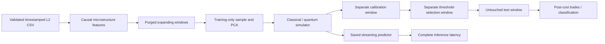

# Quantum ML Order Book Predictor

An implemented, CPU-only research pipeline for short-horizon L2 mid-price classification. It compares majority class, logistic regression, XGBoost, a compact PyTorch MLP, a PennyLane fidelity-kernel SVM, and a small variational quantum classifier.

The original project brief is preserved in [SPECIFICATION.md](SPECIFICATION.md). This implementation makes no quantum-advantage or live-profitability claim. The supplied data is synthetic; there is no exchange connectivity or order submission.

## Quick start

Run these commands **from this project directory**. Python 3.12 is the tested environment; package metadata permits Python 3.11+.

```bash
python3.12 -m venv .venv
source .venv/bin/activate
python -m pip install -r requirements.txt
python -m pip install --no-build-isolation --no-deps -e .

# macOS only: make XGBoost find PyTorch's bundled OpenMP runtime.
# This touches only the XGBoost wheel in this virtual environment.
# On other systems it is a no-op; brew install libomp is an alternative.
python benchmarks/setup_macos.py

python -m pytest -q
python benchmarks/reproduce.py --config configs/ci.yaml --output reports/ci.html
```

The local `.venv` is already installed and tested in this workspace. The smoke configuration uses 240 snapshots, one seed, one fold, two qubits, and exact/128-shot simulation. The larger demo remains small enough for a laptop CPU:

```bash
python benchmarks/reproduce.py --config configs/demo.yaml --output reports/comparison.html
python benchmarks/reproduce.py --config configs/shots.yaml --output reports/shots.html
```

`reproduce.py` uses the public CLIs below and reports only the runs it just created. It exits nonzero if either solver has failed or exceeded its budget, while still producing the report when manifests are available. Repeated experiments create new run directories and preserve existing evidence.

## Public CLI

All three commands from the specification are implemented:

```bash
python -m project.prepare_data --config configs/demo.yaml
python -m project.run --config configs/demo.yaml --solver classical
python -m project.run --config configs/demo.yaml --solver quantum-sim
python -m project.report --runs runs/ --output reports/all-runs.html
```

Paths in YAML are relative to the working directory. Dataset files are immutable: preparation is idempotent for the same generator settings, and rejects changed content or parameters at an existing path. Use a new `data_path` for a new dataset version.

Reports group different configurations, dataset hashes, source hashes and runtime environments into separate protocols. Repeated identical protocol/model/fold/seed records are rejected rather than counted as independent observations. Use `reproduce.py`, or provide a directory containing only the intended runs, when repeating the same experiment.

## Architecture



All execution logic remains classical. Quantum computation is an offline simulator experiment; neither model predictions nor the backtester send orders.

- **Features:** top-level and aggregate depth imbalance, inverse-level-weighted imbalance, microprice displacement, spread, log bid/ask depth, quote-derived order-flow imbalance, rolling OFI, one/five-snapshot returns and five-snapshot volatility. No trade tape is used or implied.
- **Labels:** down/flat/up, encoded `0/1/2`, from mid-price return between snapshot `t` and `t + horizon`. A configurable dead band is in basis points. Unavailable final labels are `-1` and never enter an experiment. The demo horizon is three snapshots (300 ms on its regularly sampled data).
- **Splits:** expanding training windows followed by distinct calibration, threshold-selection and test windows. Rows whose label endpoint reaches the next window are purged. Later windows also lose their first `embargo` observations. Test windows do not overlap; later folds may train on earlier history once its outcomes are known.
- **Sampling and reduction:** proportional class-stratified samples are drawn exclusively from each purged training window. Class coverage is maintained, indices are saved, and every model receives the same sample for a seed/fold. Standardization, PCA and the PCA-component scale are fitted only on that sample. Bounded PCA angles are the inputs to both classical and quantum models; comparisons are matched at each input/qubit count.
- **Calibration:** scalar temperature scaling is fitted only on the calibration window. Threshold selection then maximizes net validation P&L, including an explicit always-abstain choice. Test outcomes never choose temperature, threshold or hyperparameters.

## Models and budgets

The classical models are a majority-class predictor, L2-regularized logistic regression, depth-three XGBoost, and a `dimensions → 16 → 3` PyTorch MLP. All are deterministic for a fixed training sample/seed under the tested environment and run on CPU.

The quantum kernel uses angle or IQP-style data encoding, data re-uploading, and squared state overlaps. An SVM is fitted on the training Gram matrix. Finite-shot experiments sample the analytic fidelity with a binomial estimator, symmetrize the training estimates, and project negative eigenvalues out. The same positive-eigenspace projection is applied to held-out kernel rows. Exact training state caching and overlap matrix multiplication are **simulator optimizations**, not realizable QPU latency measurements.

The VQC uses the same reduced inputs, an encoding layer, trainable RY/RZ rotations and a CNOT chain, followed by a three-class linear readout of basis probabilities. SPSA jointly trains circuit angles and readout parameters. Exact runs use analytic probabilities; finite-shot runs use PennyLane sampling. A single-class training window is an explicit constant-class fallback, recorded in the manifest. Missing dependencies, numerical failures and budget overruns are recorded as failed trials, never relabeled as another successful algorithm.

`configs/demo.yaml` predeclares three seeds, two walk-forward folds, 72 training rows, two/three qubits, angle/IQP encoding and exact simulation. `configs/shots.yaml` compares exact, 128 and 1,024 shots at two qubits with both quantum models. Each model gets one fixed candidate and the same 30-second fit allowance. Native iteration caps bound work, but optimizer iterations are not comparable units across model families. Native libraries do not all expose objective evaluation counts; unavailable counts are `null`.

The wall-time allowance is checked cooperatively where possible and again after fitting. An uninterruptible native call may exceed its allowance before the result is rejected. This is a research benchmark budget, not a hard execution deadline. Model and dependency initialization are recorded separately; process bootstrap is also included in run wall time.

## Execution evaluation and streaming

The backtester takes a single base unit at the observed opposing touch after `execution_delay` snapshots, exits at the original signal's horizon, and permits only one open position. It charges observed spreads, adverse slippage and fees on both legs. If displayed depth cannot fill the unit, the evaluation fails visibly rather than assuming liquidity. No market impact, queue position, funding, borrow fees or exchange rules are modeled.

`net_bps` is the sum of individual trade returns, not a compounded portfolio return. The manifest also records quote-currency P&L, trade counts, turnover and drawdown. Cost rates are fixed before evaluation; validation and test use the same assumptions. A cost-aware abstention result is valid.

Saved predictors include the feature reducer, classifier, calibrator and selected threshold. Stream newline-delimited JSON snapshots into the server:

```bash
python -m project.stream --model runs/<run-id>/models/<model-id>.pkl < snapshots.jsonl
```

`data/example_stream.jsonl` contains five warm-up rows and ten held-out demo snapshots for trying this interface. Saved XGBoost predictions on this fixture were checked against the recorded batch predictions.

Each input row has integer UTC `timestamp_ms` and equal-length `bid_price`, `ask_price`, `bid_size`, and `ask_size` arrays, ordered from best quote outward. For a three-level model:

```json
{"timestamp_ms":1735689600000,"bid_price":[99.99,99.98,99.97],"ask_price":[100.01,100.02,100.03],"bid_size":[10,9,8],"ask_size":[8,7,6]}
```

The first five rows warm up the causal rolling context. Subsequent outputs contain calibrated down/flat/up probabilities and a direction of `-1`, `0`, or `1`. Invalid input or inference failures emit an error and a zero direction. Out-of-order snapshots are rejected. The model's horizon is in observations, so callers must maintain the intended cadence. Only load trusted local pickle files; deserialization executes Python code. Finite-shot VQC device sampling restarts from its declared seed when an artifact is loaded.

Streaming profiles time snapshot construction, validation, rolling features, scaling/PCA, encoding, inference, calibration and thresholding on a warmed model. They report raw timings, p50/p95/p99 and serial throughput. Artifact loading is timed separately. Network transport and exchange connectivity are absent. The demo's 40 observations per profile are sufficient for a smoke benchmark, not reliable production tail-latency estimation.

## Results and reproducibility

Open [the benchmark report](reports/comparison.html) for the measured table and accuracy figure, [shot ablations](reports/shots.html), or [the CI-size report](reports/ci.html). Each report has adjacent CSV and JSON exports. Per-model manifests, out-of-sample predictions, executed trades and raw latency samples are under `runs/`.

The optional [benchmark notebook](benchmarks/benchmark.ipynb) runs the same public commands, displays the reports and audits the saved split boundaries. Use this project's environment as its kernel; Jupyter itself is not required for any CLI workflow.

The initial completed demo comprises 96 trials: six model families across the configured seeds, folds and ablations, with no failed trials. On this synthetic fixture the strongest classical configuration, two-input XGBoost, obtained mean balanced accuracy about **0.482**; the strongest quantum-kernel configuration, three-qubit angle encoding, obtained about **0.432**. Majority-class balanced accuracy was **0.333**. Most validation-selected policies abstained after costs; the three-qubit angle VQC lost money on average. This run provides no evidence of quantum advantage or profitable execution. Consult the raw manifests for exact settings and measured local timing.

Reported 95% Student-t intervals first average folds within each seed and then use the three seed means. They describe algorithm/sample variability on this **one synthetic dataset**, not uncertainty over real markets. A single seed has no interval. Calibration metrics include log loss, multiclass Brier score, ECE and per-class precision/recall/F1; raw uncalibrated metrics are preserved too.

Every run records its complete configuration, Python/platform/library versions, dataset SHA-256, source SHA-256, train/calibration/validation/test indices, sampled training rows, all stage timings, warnings, failures, circuit executions, shot counts, optimizer iterations and model bytes. Model footprint is the serialized predictor size; it excludes the Python/runtime installation. No QPU was used: noise is disabled and QPU queue time, communication and cost are zero. Earlier bring-up runs, including the resolved macOS OpenMP failure, are retained in `benchmarks/diagnostics/` and excluded from the published comparison.

## Data and tests

The supplied `data/demo.csv` and `data/ci.csv` are generated by a seeded causal toy market. UTC epoch milliseconds are already normalized; timestamps are strictly increasing. Each CSV has a manifest describing its generator, seed, dimensions, interval, SHA-256 and CC0 terms for the generated data. The toy process deliberately includes autocorrelated imbalance; it is not a model of any exchange's liquidity.

For licensed external snapshots, use the same wide CSV columns: `timestamp_ms`, and each of `bid_price_0`, `ask_price_0`, `bid_size_0`, `ask_size_0` through level `levels - 1`. Supply a sibling `.manifest.json` containing at least `sha256`, `rows`, `levels`, documented `license`, source and timestamp-normalization notes; point the YAML at that file and match its row/depth settings. The loader rejects missing provenance hashes, fractional/duplicate/out-of-order timestamps, invalid prices/sizes, unsorted depth and locked/crossed books. External feed synchronization and permissions remain the dataset provider's responsibility.

The test suite covers analytic one-qubit fidelity, state normalization and positive-semidefinite exact kernels, deterministic shot accounting, known labels/microprices/OFI, future-data perturbations, train-only PCA and sampling, purged split boundaries, delayed-fill cost arithmetic, non-overlapping trades, constant-class fallback, finite-shot VQC training, calibration, model serialization, streaming/batch parity, invalid input, failed/budget-exceeded trials and the complete public CLI.

Implementation roadmap completed:

- [x] M1: labels, feature pipeline, classical baselines.
- [x] M2: training-only stratified research samples.
- [x] M3: quantum kernel and trainable VQC alternatives.
- [x] M4: encoding/shot ablations, full streaming inference profiles.
- [x] M5: walk-forward testing and post-cost execution evaluation.

The code lives in `orderbook/`; `project/` contains thin CLI entry points. The environment is pinned in `requirements.txt`, experiment configurations are under `configs/`, and reproducibility helpers are under `benchmarks/`. Rust serving and real-QPU adapters are optional extensions from the original specification and are not implemented.

Tooling references: [PennyLane default.qubit](https://docs.pennylane.ai/en/stable/code/api/pennylane.devices.default_qubit.DefaultQubit.html), [PennyLane shot configuration](https://docs.pennylane.ai/en/stable/code/api/pennylane.workflow.set_shots.html), and [PennyLane circuits](https://docs.pennylane.ai/en/stable/introduction/circuits.html).
